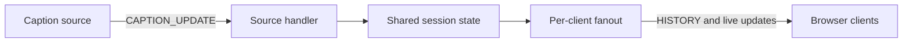

# Developer Guide

This guide explains how LiveRecall is organized and how to work on its Go backend and browser client. Use it to find the code responsible for a behavior and understand how the components fit together.

For environment setup and the application demo, see the [README](../../README.md). Message formats and validation rules are documented in the [protocol specification](protocol_specification.md). Contributor responsibilities are recorded in [Contributions](../CONTRIBUTIONS.md).

## Contents

- [Overview](#overview)
- [Repository map](#repository-map)
- [Development workflow](#development-workflow)
- [Backend components](#backend-components)
- [Browser client](#browser-client)

## Overview

Runtime wiring lives in [`cmd/distributary/main.go`](../../cmd/distributary/main.go). In live mode, one session instance is injected into both the source handler and the fanout hub. The router dispatches connections through their handler interfaces.

The diagram shows the caption data path:

The [backend component contracts](#backend-components) describe these integration points. For the resulting application behavior and retention defaults, see the README's [design notes](../../README.md#design-notes).

## Repository map

Paths below are relative to the repository root.

| Path | Responsibility |
| --- | --- |
| [`solution_server.py`](../../solution_server.py) | Python entry point used by the harness; launches the compiled Go server for the current Linux architecture. |
| [`cmd/distributary/`](../../cmd/distributary/) | Server startup, command-line flags, component wiring, HTTP file serving, and listener setup. |
| [`internal/protocol/`](../../internal/protocol/) | Message types, JSON decoding and encoding, validation, and ping/pong acknowledgement helpers. |
| [`internal/server/`](../../internal/server/) | HTTP and WebSocket routing and initial hello handling. |
| [`internal/source/`](../../internal/source/) | Caption ingestion, source replacement, and update counters. |
| [`internal/session/`](../../internal/session/) | Revision state, bounded history, and per-client cursors. |
| [`internal/fanout/`](../../internal/fanout/) | Client connections, caption delivery, and slow-client policies. |
| [`client/`](../../client/) | Browser HTML, CSS, JavaScript modules, and frontend tests. |
| [`internal/naive/`](../../internal/naive/) | Go baseline implementation for comparison with live mode. The original Python baseline is [`harness/starter_server.py`](../../harness/starter_server.py). |
| [`harness/`](../../harness/) | Provided caption source, simulated clients, submission check, and network profiles. |
| [`experiments/`](../../experiments/) | Project test runners and recorded performance results. |
| [`bin/`](../../bin/) | Compiled Linux server binaries used by the Python launcher. |
| [`Makefile`](../../Makefile), [CI workflow](../../.github/workflows/ci.yaml) | Local build and verification commands and automated checks. |
| [`docs/`](../) | Developer documentation, contribution records, and retained assignment and planning material. |

## Development workflow

Use the existing instructions for operational tasks:

| Task | Reference |
| --- | --- |
| Prepare the environment | [Ubuntu setup](../../README.md#ubuntu-setup) |
| Install dependencies and build or rebuild the server | [Install](../../README.md#install) |
| Start the application | [Required server](../../README.md#required-server) |
| Configure the browser connection | [Browser client](../../README.md#browser-client) |
| Exercise captions, reconnects, and session resets | [Application demo](../../README.md#mandatory-deterministic-application-demo) |
| Run verification and performance checks | [Public deterministic tests](../../README.md#public-deterministic-tests) |

### Work on backend changes

Locate the responsible package using the [repository map](#repository-map) and keep regression cases alongside the changed behavior in its `*_test.go` files. Scenarios that cross component boundaries belong in [`internal/itest/`](../../internal/itest/), which separates correctness, history, overload, and robustness checks.

For changes to message handling, follow the [protocol testing guidance](protocol_specification.md#7-testing). Launcher background is in the [archived launcher notes](../initial_development_docs_for_info/project-structure.md#the-launcher); verify changes against the current [launcher implementation](../../solution_server.py).

### Work on browser changes

The browser modules and their regression tests live in [`client/`](../../client/) and [`client/tests/`](../../client/tests/). Keep connection behavior, caption state, rendering, and testing controls in their respective modules. Use the linked browser and demo instructions when checking the result.

## Backend components

### Protocol (`internal/protocol`)

Use the [protocol specification](protocol_specification.md) for this package's API, message formats, validation rules, and acknowledgement encoding.

### Router (`internal/server`)

Single entry point for every connection: upgrade, read the hello within 5 s, dispatch.

* `SOURCE_HELLO` → `Sources.Handle(ws, hello)`; `CLIENT_HELLO` → `Clients.AddClient(ws, hello) error`; bad or missing hello → close 1008.
* The handler owns the connection until it returns; the router then closes it.
* Non-WebSocket HTTP goes to the optional `Static` handler (browser files), otherwise 426.
* **Fanout:** `AddClient` must take the `hello` and call `sess.Join(hello)`.

### Source handler (`internal/source`)

The only way captions enter the server, and the only caller of `Apply`: read, decode, `Apply`, count. Never sends to the source and never waits for clients.

* `New(sess, logger) *Handler`, `(h) Handle(ws, hello)`, `(h) Stats() Stats` (verdict and malformed counters, safe from any goroutine).
* Bad frames are counted and skipped. `SOURCE_DONE` is logged only. A new source replaces the old one.

### Session (`internal/session`)

Shared, bounded caption state. No I/O, no goroutines, no clock (the only time is the newest `source_ts`).
Holds a **ring of finals** (append-only, numbered by `fseq`, capped by count and age) and an **`active` map** (newest provisional per unfinished segment, overwritten by each revision).

* `New(cfg Config) *Session`: creates a session, replacing zero-valued configuration fields with `DefaultConfig()` values.
* `Apply(u *protocol.CaptionUpdate) Verdict`: source handler only. Returns `Accepted`, `Duplicate`, `Stale`, `AlreadyFinal` or `TooOld`. On `Accepted`, wakes every waiting client.
* `Join(hello *protocol.ClientHello) (history []byte, cur Cursor)`: call once per client. Send `history` first (a complete `HISTORY` frame), then keep `cur` for that client.
* `Pick(cur *Cursor, max int, provisionals bool) (frames [][]byte, wake <-chan struct{}, behind bool)`: the client's next frames. Finals in order first, then the newest provisionals.
  - `max` = send credit; `provisionals=false` in degraded mode.
  - `frames` are pre-encoded: write them as-is, never modify them.
  - Nothing to send: wait on `wake`.
  - `behind`: close with 1013; the client reconnects and recovers through `HISTORY`.
* One `Cursor` per client, used by that client's writer goroutine only.

### Fanout (`internal/fanout`)

The router integrates with fanout through the `Hub` interface; `hub` and `client` are private implementation types. The delivery policies are summarized in the README's [design notes](../../README.md#design-notes).

#### Hub

`hub` is the only gateway for other components to communicate with fanout. **The `hub` struct is not exposed to other components**, a `Hub` interface is used instead. `hub` is instantiated only through `NewHub(session *session.Session) *hub`. The following `fanout` functions are usable by other components:

* `NewHub(session *session.Session) *hub`
  - Instantiates a new `hub` that is dependent on the passed `session`.
  - All clients orchestrated by the returned `hub` will retrieve caption from the passed `session`.
  - The `hub` structure is not exported, thus all of its inner structure are non accessible from other components. This also prevents instantiation of `hub` outside of `NewHub()`.
* `(h *hub) AddClient(connection *websocket.Conn, hello *protocol.ClientHello) error`
  - Adds a new client connection to `hub`.
  - Trying to add a client to a `hub` that has been shutted down will return an error.
  - This is a blocking function. It will not return unless there is an error or the client connection is terminated.
  - The HTTP router calls `AddClient()` synchronously; it keeps the upgraded connection open until both client pumps exit.
* `(h *hub) Shutdown()`
  - Shuts a `hub` down and terminates all connections orchestrated by it.
  - After `Shutdown()`, the `hub` will no longer be usable. Another `hub` must be instantiated through `NewHub()`.
  - This function wraps `helperShutdown()`, which consist the steps to shut a `hub` down, inside a `sync.Once` to ensure that multiple concurrent calls to `Shutdown()` will yield in only one execution of `helperShutdown()`.

`hub` also holds all parameters used for enforcing client connection policy. The details can be observed in `hub`'s `struct` definition.

#### Client

`client` is responsible to handle independent per-client connection. Every instance of `client` handles the connection and enforces policies independently from other instances. `client` is not exposed to other component to reduce coupling. `client`'s `struct` holds statistics necessary to decide how to enforce the connection policies based on the parameters given in `hub`'s `struct`. Below are useful `client`'s method that are important to understand how `client` works:

* `(c *client) readPump(wg *sync.WaitGroup, ctxCancel context.CancelFunc)`
  - Acts as the sole reader from the websocket connection. It ensures independence between reading and writing task to prevent concurrency problems.
  - The function main responsibility is to handle pong frame. There are 2 types of pong: keep alive pong and acknowledgement pong. For each acknowledgement pong read, the function will compute statistics to determine the status of a client (normal or degraded). Each client status carries its own policies.
  - Helper functions used to compute statisics and to determine client's status are `(c *client) computeSRTT(alpha float64)`, `(c *client) computeMinRTT()`, `(c *client) computeQueueDelay()`, `(c *client) determineStatus()`.
  - This function must be run inside a go routines.
* `(c *client) writePump(wg *sync.WaitGroup, ctx context.Context)`
  - Acts as the sole writer to the websocket connection.
  - The function responsibilities are to retrieve captions from `Session` through `hub` and to send captions to client based on policies tied to client's status.
  - Helper functions used is `(c *client) write(caption []byte, writerCtx context.Context) error`. The writing process is separated from `writePump()` mainly to improve readibility.
  - This function must be run inside a go routines.
* `(c *client) write(caption []byte, writerCtx context.Context) error`
  - Executes writing to the websocket connection when called by `writePump()`.
  - Helper functions used is `(c *client) startPingingMode(num uint64, writerCtx context.Context, acked chan struct{}) error`. Pinging mode is when the server sends acknowledgement ping to the client. For normal client, it is sent every `hub.maxInFlight` sequences. For slow client, it is sent for every sequence.
* `(c *client) startPingingMode(num uint64, writerCtx context.Context, acked chan struct{}) error`
  - Sends acknowledgement ping to the client.
  - This function will wait for `readPump()` to notify that and acknowledgement pong has been received from the client.
  - If no notification from `readPump()` for `hub.pongTimeout` time, the function will return an error. The error will be propagated to `writePump()` which will trigger connection termination.

## Browser client

Use this module map to locate browser implementation changes. User-facing behavior and controls are covered by the [application demo](../../README.md#mandatory-deterministic-application-demo); connection configuration is covered by the README's [browser client instructions](../../README.md#browser-client).

| Module | Implementation responsibility |
| --- | --- |
| [`app.js`](../../client/app.js) | Composes the store, connection, UI, and testing tools; routes received frames through the store before rendering. Owns the periodic purge timer. |
| [`config.js`](../../client/config.js) | Resolves and validates the backend URL through `getWebSocketUrl()`. |
| [`connection.js`](../../client/connection.js) | Owns the WebSocket lifecycle, hello construction, client identity helpers, retry timers, and guards against events from superseded sockets. |
| [`captions.js`](../../client/captions.js) | Stores captions by session and segment, namespaces persisted state by endpoint and session, and exposes `acceptUpdate()`, `getHistory()`, and `getResumePosition()`. |
| [`ui.js`](../../client/ui.js) | Owns caption and recall DOM updates through `createUI()`; receives state access through callbacks. |
| [`testing-tools.js`](../../client/testing-tools.js) | Wires taskbar DOM events to caption-store and connection actions. |

Element IDs in [`index.html`](../../client/index.html) are referenced directly by the UI and testing tools modules. Keep those references in step when changing markup. Module regression cases live in [`client/tests/`](../../client/tests/).
