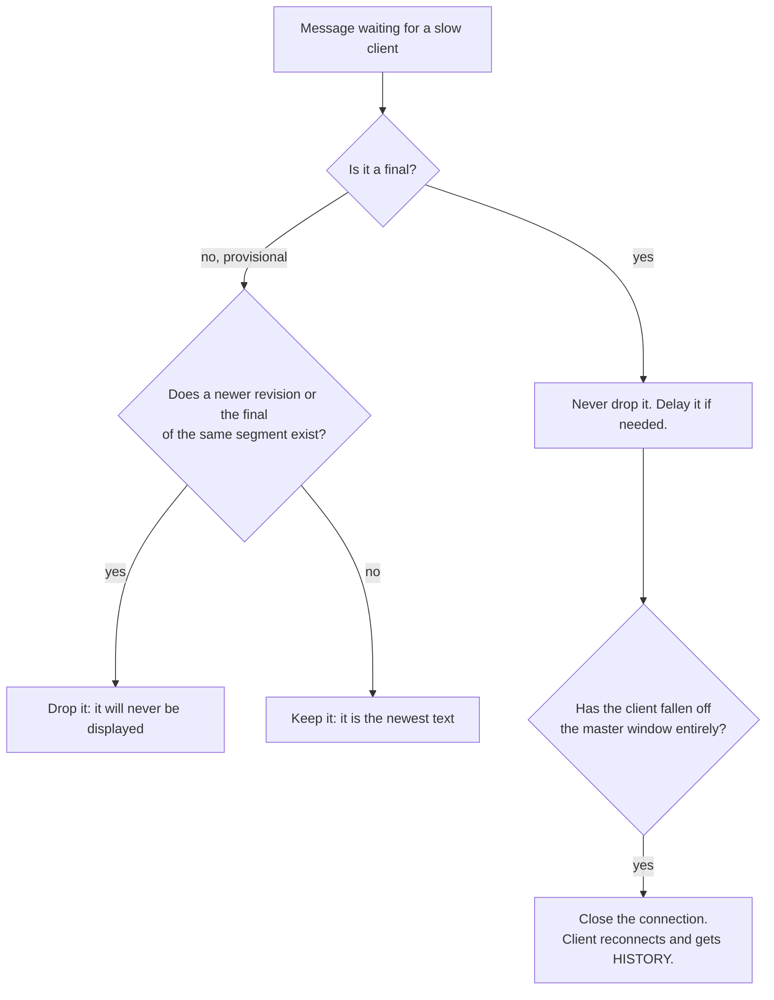
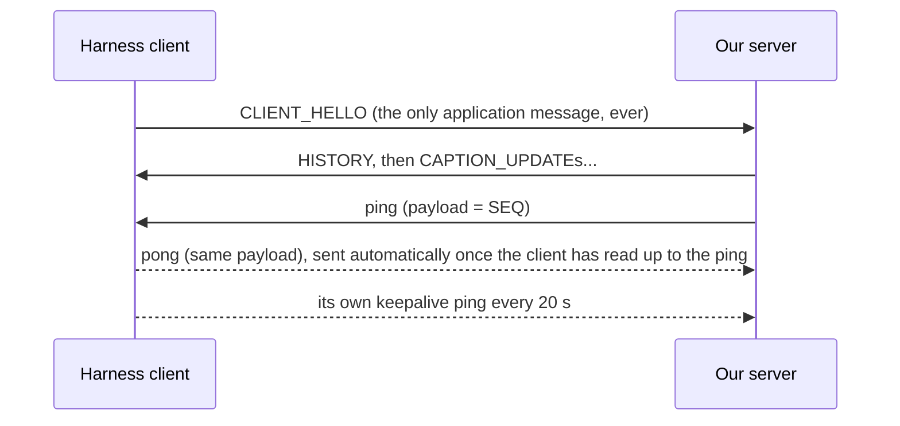

# Plan Review

A check of `docs/plan.md` ("Details to Solve" and "Architecture") against the Assignment 4 spec and the professor's harness. Most of the plan holds up. Two points would cost marks as written (slow readers, the disconnect rule), one needs adjusting (late join), one can be dropped (clock sync), and three things the spec requires are missing.

Every finding below follows the same shape so it can be explained without the code:

- **The plan says:** the line from `plan.md`.
- **What goes wrong:** the problem in plain words.
- **Picture it:** a small concrete example.
- **Fix:** what to do instead.
- **In the viva:** one or two sentences to say if asked.

## Scorecard

| # | Plan item | Verdict | In one line |
| --- | --- | --- | --- |
| 1 | Replay from the client's own local buffer | **Keep** | Exactly what "What did I miss?" requires |
| 2 | Client totally out of the window → treat as a late join | **Keep** | Spec allows losing what no longer overlaps |
| 3 | Server window start > client window end → close the WebSocket | **Keep** | Right last resort; the harness will count it as a connection error |
| 4 | Slow client = SEQ - ACK > n | **Keep** | Right signal, but ACK has to come from ping/pong |
| 5 | Slow readers: bounded queue, overwrite the oldest entry | **Change** | Overwrites finals first and still leaves the client stale |
| 6 | Disconnect = no ack/req for 20 s | **Change** | Harness clients never send ack/req, so every client would be dropped |
| 7 | Late join starts from the earliest point of the server window | **Adjust** | The client says how much history it wants (`history_seconds`) |
| 8 | Sync every client's clock to the server | **Drop** | Not possible for harness clients, and not needed |
| 9 | (missing) Revision rules | **Add** | Older revisions must never overwrite newer ones |
| 10 | (missing) Finals go out in order | **Add** | One out-of-order final can be lost forever |
| 11 | (missing) TCP segment size cap | **Add** | The 2 Mbit/s test profile freezes connections otherwise |

## What already fits

- **Replay from a local buffer (1).** Requirement 3: "What did I miss?" must use captions already stored in the client. Only a real gap (disconnect, late join) needs the server.
- **Out of the window means late join (2) and closing the socket (3).** Requirement 5 asks for recent missed finals "without replaying the entire lecture", so losing what fell out of the window is allowed. One side effect: when *we* close a connection, `load_clients.py` logs a `CONNECT_ERROR`, so these show up as "Connection errors" in results. Mention it in the report.
- **SEQ - ACK > n (4).** This is the right way to spot a slow reader. Finding 6 explains where ACK comes from.
- **The protocol package** already has what findings 6 and 7 need: `EncodeAck`/`DecodeAck` put a sequence number in pings, and `EncodeHistory` builds `HISTORY` from pre-encoded captions.

## Finding 5: slow readers (Change)

**The plan says:** "Producer-Consumer architecture with a bounded queue ... If a consumer is too slow, the oldest information that has not been consumed may be replaced."

**What goes wrong:** two things.

1. *It throws away the wrong messages.* The oldest unread messages for a lagging client are usually its oldest **finals**. Overwriting them loses exactly what the spec says must always arrive (section 4.3). Meanwhile it keeps newer provisional revisions that are about to be replaced anyway. If final completeness drops below 99%, hidden performance is capped at 15/30.
2. *Bounded is not the same as fresh.* A full queue of 64 messages in front of a client reading 2 per second means everything it reads is about 32 s old. Spec section 10 says the slow-reader challenge rewards behaviour "materially stronger than a conventional queue-based implementation". A bounded FIFO *is* that conventional implementation.

**Picture it.** A slow client's queue holds 6 messages and is full. The next message, segment 42's final, arrives:

| Slot | Queue now | Overwrite-oldest keeps | Drop-by-meaning keeps |
| --- | --- | --- | --- |
| 1 | seg 40 **final** | ~~seg 40 final~~ (overwritten: lost forever) | seg 40 **final** |
| 2 | seg 41 rev 1 | seg 41 rev 1 (useless: 41 is final) | |
| 3 | seg 41 rev 2 | seg 41 rev 2 (useless) | |
| 4 | seg 41 **final** | seg 41 **final** | seg 41 **final** |
| 5 | seg 42 rev 1 | seg 42 rev 1 (useless: 42 is final) | |
| 6 | seg 42 rev 2 | seg 42 rev 2 (useless) | |
| new | seg 42 **final** | seg 42 **final** | seg 42 **final** |

Overwrite-oldest loses a final and keeps four messages nobody will ever display. Dropping by meaning keeps every final in half the space.

**Fix: drop by meaning, not by age.**



In practice this needs no per-client queue at all:

- **Finals** live once, in the shared master window. Each client only keeps a bookmark: "the last final I sent you". Catching up means reading forward from the bookmark.
- **Provisionals** live in one slot per active segment, overwritten by each newer revision. A client is sent whatever is in the slot if it is newer than what that client already has.

**Fix the "silly proof" too.** It proves the queue is bounded, which is necessary but not enough. The design needs three claims:

| Claim | Why it holds with the fix |
| --- | --- |
| **Bounded:** memory never grows without limit | The master window has a size cap; each client adds only a bookmark and a few counters |
| **Complete:** every final reaches every connected client | Finals are never dropped, only delayed; the bookmark reads them in order. A client that falls off the window reconnects and gets them via `HISTORY` (up to 60 s). |
| **Fresh:** a slow client converges to the newest text | Superseded provisionals are skipped, so a client never reads text that is already out of date |

**In the viva:** "A provisional revision can be dropped once a newer revision or the final of the same segment exists, because nobody will ever display it. A final is never dropped, only delayed. If a client falls so far behind that its finals have left our window, we disconnect it and it recovers through `HISTORY`."

## Finding 6: the disconnect rule (Change)

**The plan says:** "Disconnect is when no ack/req received for 20s."

**What goes wrong:** after `CLIENT_HELLO`, harness clients never send another application message. We can't change them, and the hidden evaluator uses its own copies. Under this rule, every client would be disconnected 20 s after joining.

**Picture it.** Everything a harness client ever sends:



So the only "acks" we will ever get are **pongs to our own pings**. That is also where ACK in "SEQ - ACK > n" comes from: put SEQ in the ping payload (`protocol.EncodeAck`) and read it back from the pong (`protocol.DecodeAck`).

**A second trap: slow but alive.** A slow client answers our ping only after reading every frame queued ahead of it, and its library queues up to 16 frames. So the pong is late, not missing:

| Slow client reads one message every | Pong can be delayed by up to |
| --- | --- |
| 500 ms (public T3) | about 8 s |
| 1 s | about 16 s |
| 2 s | about 32 s: over 20 s, so a slow but healthy client gets disconnected |

The hidden evaluator varies the slow-reader rate, so a fixed "pong within 20 s" rule will eventually disconnect clients we are supposed to serve.

**Fix: slow means the ACK moves slowly; dead means it does not move at all.**

- **Slow:** SEQ - ACK > n. Stop sending provisionals to it (Finding 5), keep sending finals as ACKs come back.
- **Dead:** ACK has not moved for 20 s *while messages are in flight*, or a single write has been blocked for about 10 s. Close the connection.

**In the viva:** "The harness clients never send acknowledgements, so we piggyback on WebSocket ping/pong: the ping carries how many messages we have sent, and the pong echoes it back once the client has read that far. A slow client's ACK still moves; a dead client's doesn't."

## Finding 7: late join (Adjust)

**The plan says:** "Start from earliest point of the Server's window."

**What goes wrong:** the client says how much history it wants: `history_seconds` in `CLIENT_HELLO`, defined by spec 4.2 as "the amount of recent recovery context (up to 60 seconds)". Starting from the earliest point of our window ignores that, and makes late-join behaviour depend on an internal setting. If we later grow the window from 90 s to 120 s to tune something else, late joiners suddenly receive more history.

**Picture it.** Our window holds 90 s. A late client asks for 30 s. The plan sends 90 s; the spec says 30.

**Fix:** reply with finals where `segment > last_segment` and `source_ts` is within `history_seconds` of the newest `source_ts` we have seen. Then continue live from exactly where `HISTORY` stopped.

**One honest tradeoff:** the public analyser expects every client to have *every* final, including ones sent before a late client joined. So sending more history would raise measured completeness. That is a question for the professor (it is already in the design doc's open questions). Until then, follow the spec's wording.

**In the viva:** "A late joiner tells us how many seconds of context it wants, up to 60. We send exactly the finals in that window it doesn't already have, then switch it to the live stream at the same point, so nothing is duplicated or skipped."

## Finding 8: clock sync (Drop)

**The plan says:** "All clients' clock are sync to the server clock."

**What goes wrong:** harness clients can't run a clock-sync protocol, and the browser doesn't need one.

**Fix:** every caption already carries `source_ts`, the source's timestamp. Use it as the one timeline for everything:

- the browser's 15/30/60 s "What did I miss?" views count back from the newest `source_ts` it holds;
- the server's `HISTORY` window does the same.

In every test, the source, server and clients run on the same machine, so their clocks already agree.

**In the viva:** "We never compare clocks. Every caption carries the time the source sent it, and all our time windows are measured on that timeline."

## Finding 9: revision rules (Add)

The plan never says what happens when revisions arrive out of order or twice. The spec does, and the viva asks "why can an older revision never overwrite a newer one?" The server should accept a `CAPTION_UPDATE` only if all of these hold:

1. Its segment is not already final. A final is permanent.
2. Its revision is higher than the one already stored for that segment. Equal means duplicate; lower means stale.
3. Its segment is still inside the master window.

**In the viva:** "Each segment remembers its highest revision. Anything lower or equal is dropped as stale or duplicate, and once a segment is final nothing can change it."

## Finding 10: finals go out in order (Add)

**What goes wrong without it:** the harness resumes from the **highest** final it has seen, and `HISTORY` skips everything up to that number.

**Picture it.** A client receives segment 41's final before segment 40's (say, because finals came from two different code paths), then disconnects. It reconnects saying `last_segment = 41`. `HISTORY` correctly skips everything up to 41, so segment 40 is now unrecoverable for that client.

**Fix:** each client's bookmark reads finals from the master window strictly in order, and nothing else ever sends a final.

**In the viva:** "Clients resume from the highest final they hold, so we must never let a client hold final 41 without final 40. Finals only ever reach a client in order, through one bookmark."

## Finding 11: TCP segment size cap (Add)

**What goes wrong:** the professor's `bandwidth_2mbit.sh` uses a 4 KB token bucket on loopback, whose MTU is 64 KB. Any TCP segment over about 4 KB is dropped on every retry, so the connection freezes. We measured this:

- single writes of 3,900 B or less arrive, while writes of 4,200 B or more never arrive;
- 200 back-to-back 200-byte messages also freeze, because TCP merges them into one large segment once a queue builds;
- a 60 s `HISTORY` is about 16 KB, so reconnecting clients would never recover under this profile.

**Fix:** set `TCP_MAXSEG` to 1400 on the listening socket (in Go, through `net.ListenConfig{Control: ...}`). With that, both test cases delivered in under 0.2 s.

**In the viva:** "Under the bandwidth profile, large TCP segments are silently dropped forever, so we cap the segment size at 1400 bytes on our listening socket."

## The plan's open questions, answered

| Question in `plan.md` | Answer |
| --- | --- |
| Send by byte or by English word? | Neither. The protocol fixes the unit: one whole caption revision per `CAPTION_UPDATE`. |
| Client totally out of window: fast-forward and lose what doesn't overlap? | Yes. Treat it as a late join (Finding 7). The spec allows it. |
| What is a slow client? | SEQ - ACK > n, with ACK from pongs (Finding 6). |
| What is a total disconnect? | ACK has not moved for 20 s while something is in flight, or a write is blocked for about 10 s (Finding 6). |

## Suggested replacement for "Details to Solve"

```markdown
### Details to Solve
1. Timeline:
   - Every caption carries source_ts; all time windows (client recall, server HISTORY) use it. No clock sync.
2. Replay:
   - Clients replay "What did I miss?" from their own local buffer of finals (>= 60 s).
3. Accepting captions (server):
   - Drop if the segment is already final, the revision is not higher than the stored one, or the segment has left the master window.
4. Slow readers:
   - One shared master window: a bounded ring of finals (by time and count) + the newest provisional per active segment.
   - Per client: a bookmark into the finals, the last revision sent per active segment, SEQ and ACK.
   - SEQ goes in each ping payload; ACK comes back in the pong.
   - Slow = SEQ - ACK > n: stop sending superseded provisionals. Finals are never dropped, only delayed, and always sent in order.
   - Proof obligations: bounded, complete (every final), fresh (converges to newest text).
5. Disconnect:
   - Dead = ACK unchanged for 20 s while messages are in flight, or a write blocked for ~10 s. Close it.
   - Bookmark fell off the master window: close it; the client reconnects and gets HISTORY.
6. Reconnect and late join:
   - HISTORY = finals with segment > last_segment and source_ts within history_seconds of the newest source_ts.
   - Live stream continues from exactly where HISTORY stopped (no gap, no duplicate).
7. Transport:
   - TCP_MAXSEG 1400 on the listening socket (bandwidth profile freezes larger segments).
```

## Glossary

| Term | Meaning |
| --- | --- |
| Segment | One caption sentence. Numbered 1, 2, 3 ... by the source. |
| Revision | One version of a segment's text. Higher is newer. |
| Provisional | A revision with `final=false`. Can be replaced by a newer one. |
| Final | The revision with `final=true`. Permanent; must reach every client. |
| Master window | The server's shared, bounded store of recent finals plus the newest provisional per active segment. |
| Bookmark (cursor) | Per client: the last final sent to it. Pending finals are everything after it in the master window. |
| SEQ / ACK | Messages sent to a client / messages it has confirmed reading (echoed back in a pong). |
| Conflation | Skipping superseded provisionals so a slow client only gets the newest text. |
| `HISTORY` | The server's reply to `CLIENT_HELLO`: recent finals the client is missing, oldest first. |
